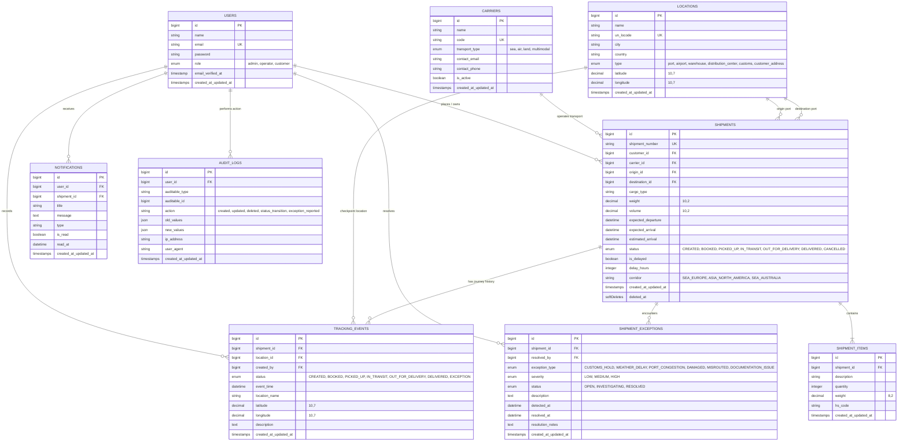

# Entity-Relationship Diagram (ERD) & Data Dictionary — CargoTrace

Dokumentasi rancangan basis data (*database design*) dan kamus data (*data dictionary*) untuk platform **CargoTrace** sesuai spesifikasi Slide 11 & Slide 18 UAS Pemrograman Web 2.

---

## 1. Visual Entity-Relationship Diagram (Mermaid)

---

## 2. Kamus Data (*Data Dictionary*)

### 2.1 Tabel `users`
Menyimpan kredensial autentikasi pengguna dan hak akses peran (*Role-Based Access Control*).

| Kolom | Tipe Data | Keterangan / Batasan |
| :--- | :--- | :--- |
| `id` | BIGINT (PK) | Auto increment primary key |
| `name` | VARCHAR(255) | Nama lengkap pengguna |
| `email` | VARCHAR(255) (UK) | Alamat email unik (digunakan untuk login) |
| `password` | VARCHAR(255) | Kata sandi terenkripsi (Hash Bcrypt) |
| `role` | ENUM | Pilihan peran: `admin`, `operator`, `customer` |
| `created_at` / `updated_at` | TIMESTAMP | Waktu pembuatan dan pembaruan data |

### 2.2 Tabel `carriers`
Menyimpan operator logistik, maskapai kargo udara, dan armada kapal laut.

| Kolom | Tipe Data | Keterangan / Batasan |
| :--- | :--- | :--- |
| `id` | BIGINT (PK) | Auto increment primary key |
| `name` | VARCHAR(255) | Nama ekspedisi / maskapai |
| `code` | VARCHAR(50) (UK) | Kode unik ekspedisi (misal: `MSK`, `EVG`) |
| `transport_type` | ENUM | Moda: `sea`, `air`, `land`, `multimodal` |
| `is_active` | BOOLEAN | Status aktif operator |

### 2.3 Tabel `locations`
Menyimpan pelabuhan laut, bandar udara, dan hub logistik global berstandar PBB UN/LOCODE.

| Kolom | Tipe Data | Keterangan / Batasan |
| :--- | :--- | :--- |
| `id` | BIGINT (PK) | Auto increment primary key |
| `name` | VARCHAR(255) | Nama fasilitas / pelabuhan |
| `un_locode` | VARCHAR(10) (UK) | Kode resmi UN/LOCODE (misal: `IDTPP`, `NLRTM`) |
| `city` / `country` | VARCHAR(255) | Nama kota dan negara |
| `type` | ENUM | `port`, `airport`, `warehouse`, `customs`, dll. |
| `latitude` / `longitude` | DECIMAL(10,7) | Titik koordinat GPS untuk Leaflet Maps |

### 2.4 Tabel `shipments`
Tabel transaksi utama untuk data manifest kargo dan siklus hidup pengiriman.

| Kolom | Tipe Data | Keterangan / Batasan |
| :--- | :--- | :--- |
| `id` | BIGINT (PK) | Auto increment primary key |
| `shipment_number` | VARCHAR(50) (UK) | Nomor resi/lacak unik (contoh: `TRK-EXP-2026-001`) |
| `customer_id` | BIGINT (FK) | Relasi ke `users.id` (pemilik kargo) |
| `carrier_id` | BIGINT (FK) | Relasi ke `carriers.id` |
| `origin_id` / `destination_id` | BIGINT (FK) | Relasi ke `locations.id` |
| `status` | ENUM | State machine status kargo |
| `expected_departure` | DATETIME | Jadwal keberangkatan awal |
| `expected_arrival` | DATETIME | Jadwal kedatangan target (SLA) |
| `estimated_arrival` | DATETIME | Estimasi kedatangan dinamis (ETA) |
| `is_delayed` | BOOLEAN | Penanda keterlambatan otomatis |
| `delay_hours` | INTEGER | Jumlah jam keterlambatan (Formula Haversine/ETA Engine) |

### 2.5 Tabel `tracking_events`
Riwayat kronologis perpindahan kargo (*append-only timeline*). Tidak pernah menimpa rekaman lama.

| Kolom | Tipe Data | Keterangan / Batasan |
| :--- | :--- | :--- |
| `id` | BIGINT (PK) | Auto increment primary key |
| `shipment_id` | BIGINT (FK) | Relasi ke kargo terkait |
| `location_id` | BIGINT (FK) | Relasi ke fasilitas pelabuhan |
| `created_by` | BIGINT (FK) | Relasi ke operator pembuat checkpoint |
| `status` | ENUM | Status pada saat pemindaian |
| `event_time` | DATETIME | Timestamp pencatatan fisik |
| `latitude` / `longitude` | DECIMAL(10,7) | Koordinat aktual pemindaian |
| `description` | TEXT | Keterangan pos pemeriksaan |

### 2.6 Tabel `shipment_exceptions`
Pencatatan kendala dan anomali operasional kargo.

| Kolom | Tipe Data | Keterangan / Batasan |
| :--- | :--- | :--- |
| `id` | BIGINT (PK) | Auto increment primary key |
| `shipment_id` | BIGINT (FK) | Relasi ke kargo yang terkendala |
| `exception_type` | ENUM | `CUSTOMS_HOLD`, `WEATHER_DELAY`, `PORT_CONGESTION`, dll. |
| `severity` | ENUM | Tingkat keparahan: `LOW`, `MEDIUM`, `HIGH` |
| `status` | ENUM | `OPEN`, `INVESTIGATING`, `RESOLVED` |
| `detected_at` / `resolved_at` | DATETIME | Waktu kejadian dan penyelesaian |

### 2.7 Tabel `notifications` & `audit_logs`
- `notifications`: Notifikasi dalam aplikasi (*in-app notification*) untuk user ketika kargo berpindah status atau mengalami keterlambatan.
- `audit_logs`: Rekaman jejak audit sistem (*system audit trails*) yang mencatat aktor, aksi, data lama vs data baru (*before/after JSON values*), IP address, dan User Agent. Khusus diakses oleh role Administrator.
